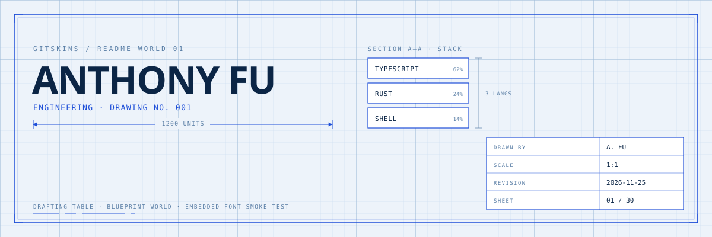

# README smoke test — embedded font + prefers-color-scheme

Phase 0 gate: does a generated SVG with a base64-embedded font survive GitHub's
image proxy (camo), and does `<picture>` switch variants with the viewer's theme?

<picture>
  <source media="(prefers-color-scheme: dark)" srcset="https://raw.githubusercontent.com/whoissanity/readme-smoke/main/assets/hero-dark.svg?v=1">
  
</picture>

## What this checks

1. `@font-face` with a `data:font/woff2;base64,…` source renders inside an SVG
   loaded as `` (GitHub blocks external resources in SVG images).
2. GitHub's camo proxy serves the SVG as `image/svg+xml` and keeps the query
   string, so `?v=` cache-busting works.
3. `<source media="(prefers-color-scheme: dark)">` is honoured by GitHub's
   markdown sanitiser with absolute `srcset` URLs.
4. The 1200×400 sheet scales to the README column and to mobile without cropping.

Pushed to `whoissanity/readme-smoke` on 2026-11-25.

## Markdown-syntax control

Same asset referenced with Markdown image syntax instead of `<picture>`, to see
whether GitHub proxies repository assets through camo or serves them from
`raw.githubusercontent.com` directly:

